

<a href="https://github.com/Roylyl?tab=overview">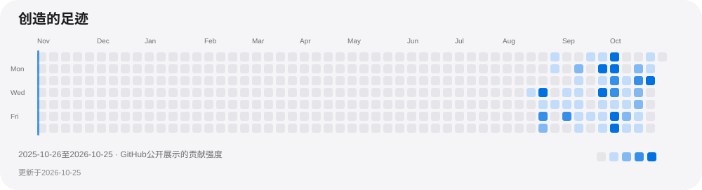</a>

    

  

<a href="https://roylyl.github.io/#projects">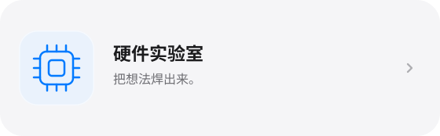</a><a href="https://roylyl.github.io/#music">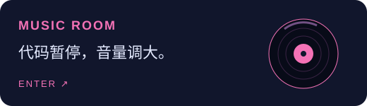</a>

<a href="https://github.com/Roylyl/WinPlay"></a><a href="https://github.com/Roylyl/MacPlay">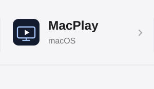</a><a href="https://github.com/Roylyl/LinuxPlay"></a><a href="https://github.com/Roylyl/AndroidPlay"></a>

<a href="https://github.com/Roylyl/SoundTest"></a><a href="https://github.com/Roylyl/ASRtest">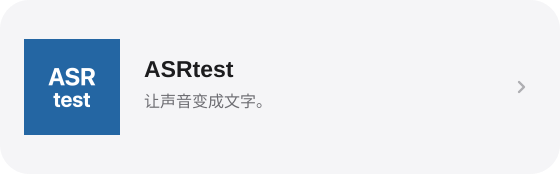</a>

<a href="https://github.com/Roylyl/READMEWriter"></a>

   <a href="https://developer.apple.com/xcode/">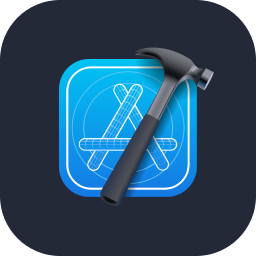</a>

<a href="https://roylyl.github.io/">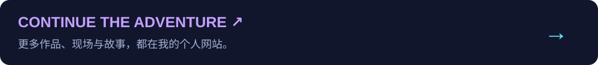</a>

