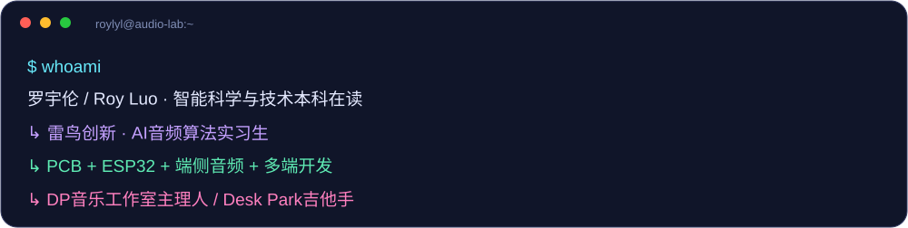
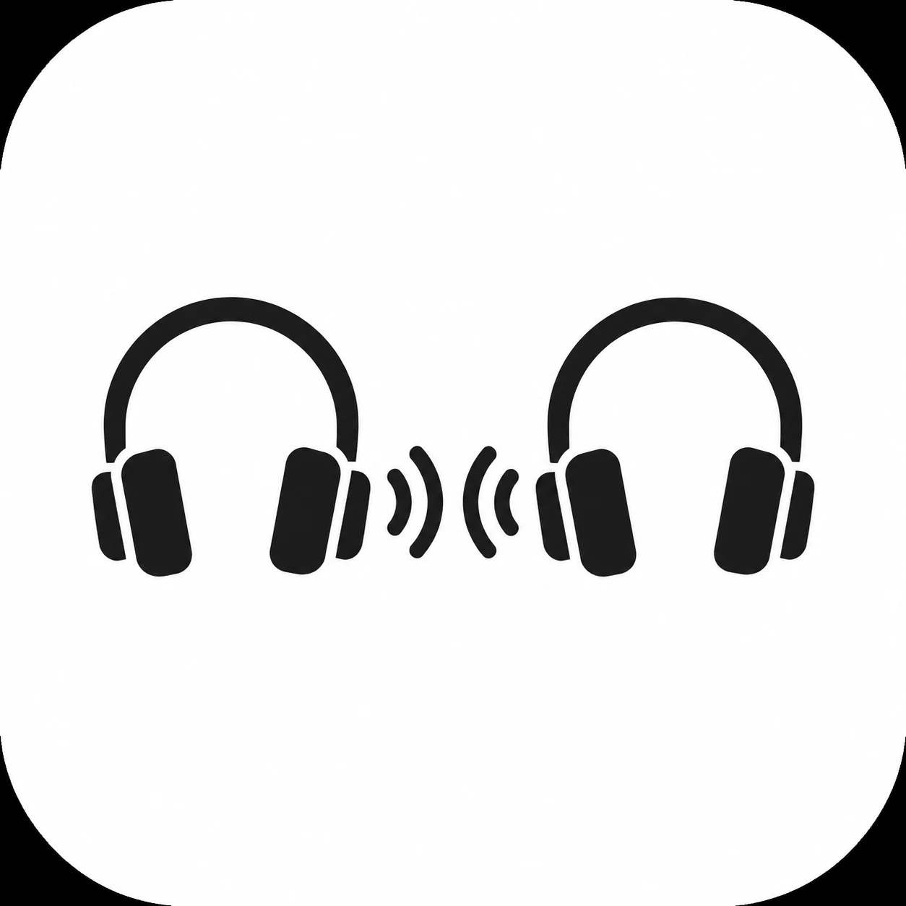
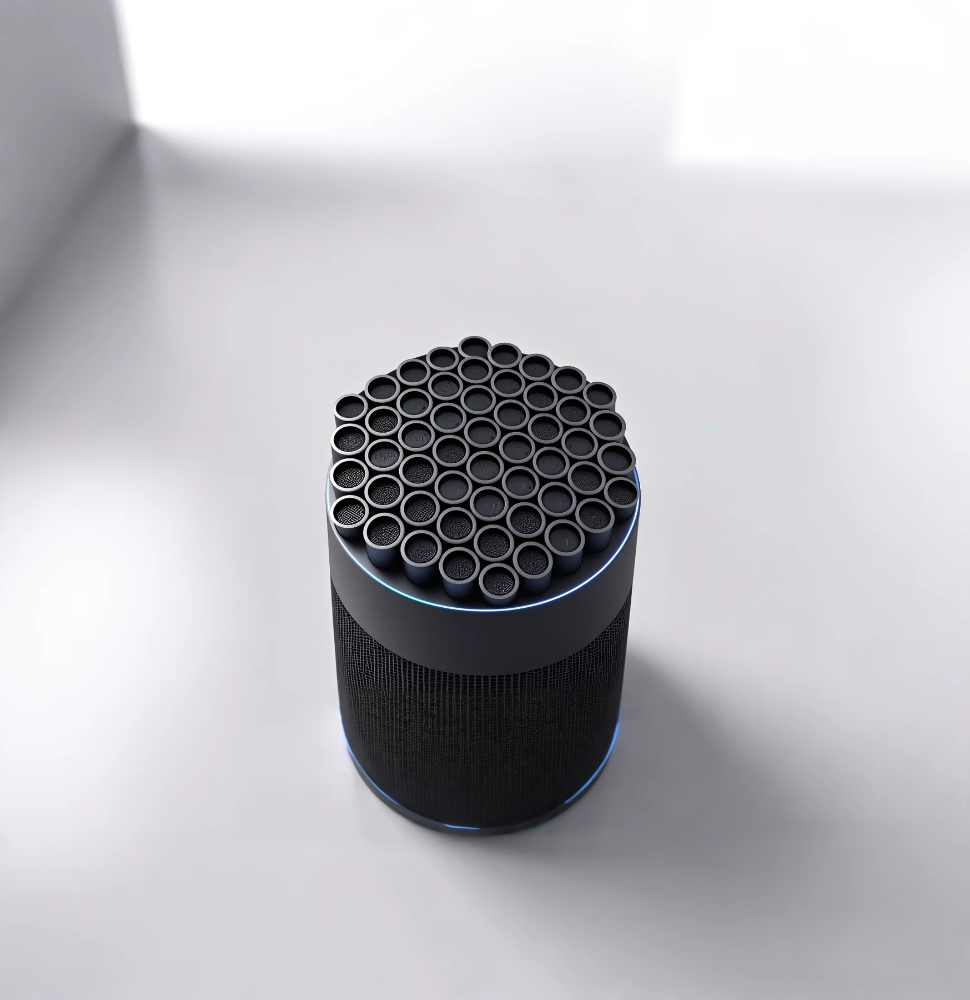
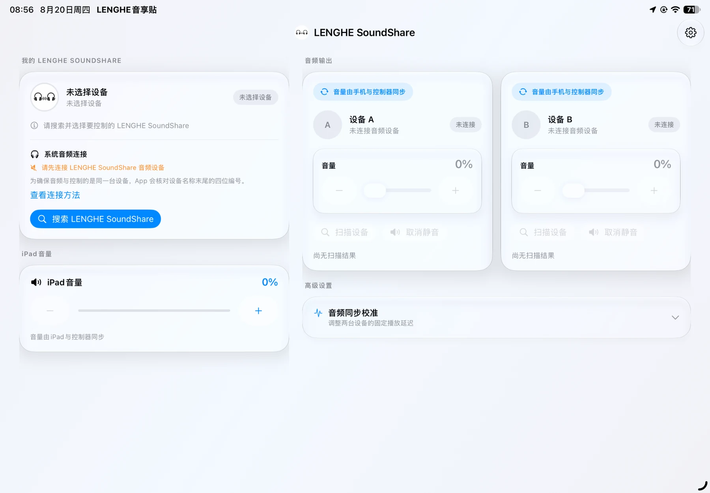
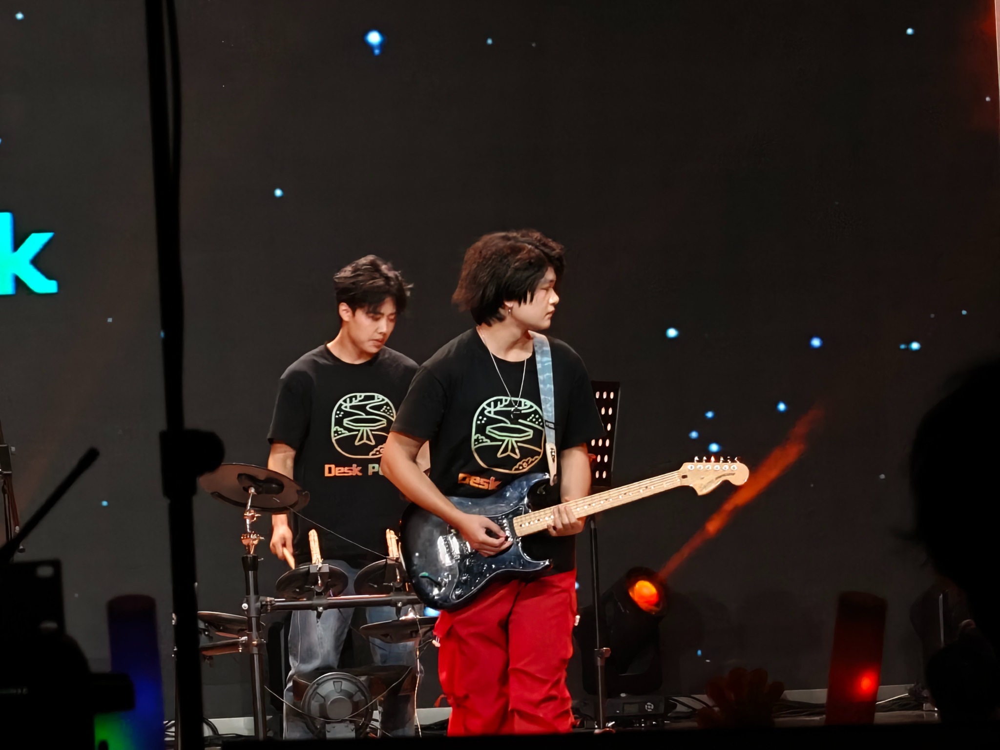
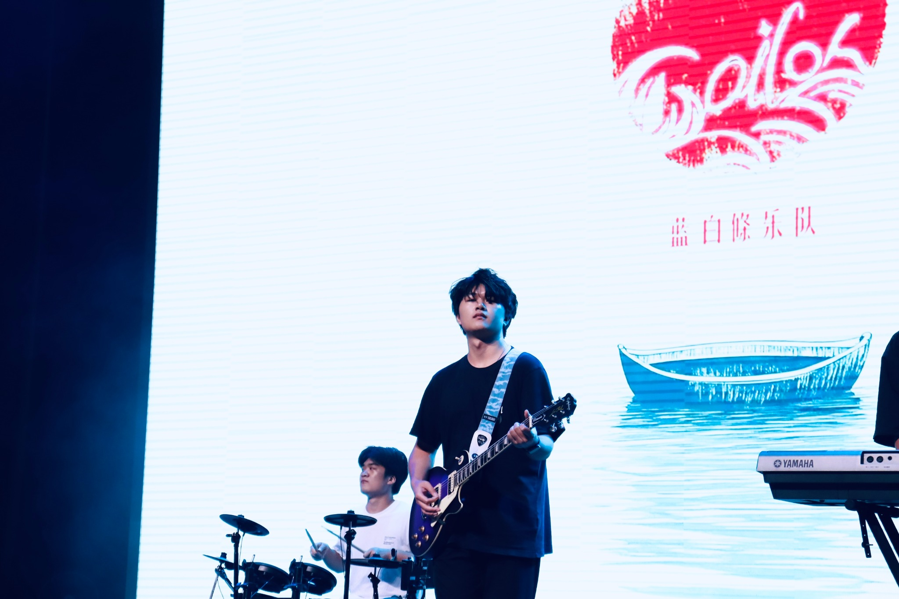

<h1 align="center">⚡ Welcome to Roylyl’s Lab ⚡</h1>

    

  

<h2 align="center">👾 PLAYER PROFILE</h2>

<h2 align="center">🛠️ HARDWARE × REAL WORLD</h2>

<table>
<tr>
<td width="50%" align="center"><h3>🎧 音享贴SoundShare</h3>
一份音乐，多个终端。

<code>PCB</code> <code>A2DP</code> <code>多端控制</code>
</td>
<td width="50%" align="center"><h3>🔊 超声波定向扬声器</h3>
让声音，有方向。

<code>ESP32</code> <code>40kHz</code> <code>超声调制</code>
</td>
</tr>
</table>

 音享贴 · 从电路到多端控制

<h2 align="center">🚀 OPEN SOURCE ARCADE</h2>

点击卡片，进入项目。

   

<h2 align="center">🧩 MY TECH PLAYGROUND</h2>

    

   

   

<h2 align="center">📊 GITHUB DASHBOARD</h2>

公开GitHub数据 · 语言分布按仓库代码统计

<h2 align="center">🎸 OFFLINE MODE: ON STAGE</h2>

 

DP音乐工作室主理人 · Desk Park乐队吉他手

 

📂 展开我的经历与项目背景

| 时间 | 经历 | 工作方向 |
| --- | --- | --- |
| 2026.09—至今 | 雷鸟创新 · AI音频算法实习生 | 端侧音频模型接入、批量推理、耗时统计与模型对照 |
| 2026.08—2026.09 | 湖南康通电子 · 硬件部实习生 | 智能陪伴机器人调研、设备与App交互、原型联动与硬件测试 |
| 2026.01—2026.02 | 深圳科创学院 · 市场调研实习 | 消费电子产品、竞品、应用场景与用户需求研究 |
| 2025.07—2025.08 | 长沙市印梦科技 · 设备调试与测试实习 | 超声波刀参数调试、性能测试与异常复现 |
| 2024.09—2028（预计） | 湖南农业大学 · 智能科学与技术本科 | 卓越工程师学院，嵌入式、硬件与AI应用实践 |

音享贴由我独立完成首版PCB、嵌入式音频链路和Android、iOS、微信小程序、Apple Watch控制端；超声波定向扬声器由我担任项目负责人。更多设计、演示与工程细节见[个人官网](https://roylyl.github.io/)。

💬 欢迎交流硬件、嵌入式、音频与端侧AI，也欢迎相关实习机会。

 

